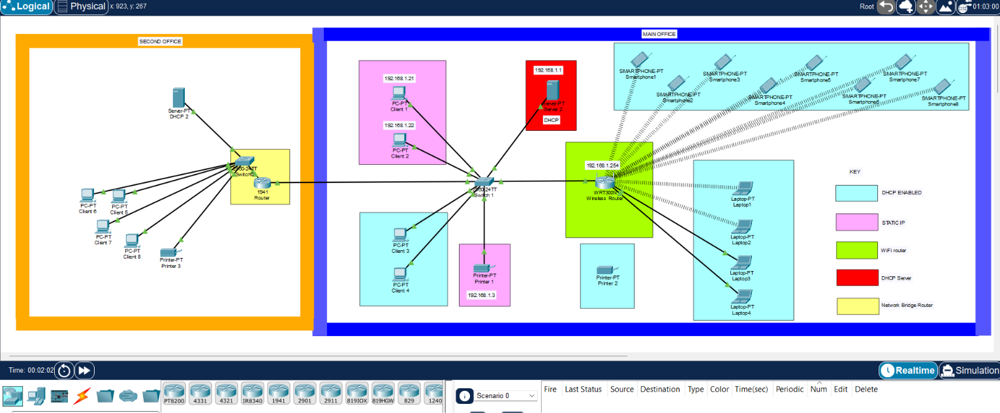

# Network Infrastructure & Troubleshooting Lab

## Project Overview

This project demonstrates a multi-office network infrastructure designed and simulated using Cisco Packet Tracer.

## Network Components

- Cisco 1941 Router
- Network switches
- DHCP servers
- Desktop computers
- Laptop devices
- Network printers
- Wireless router
- Wired and wireless connections

## Network Architecture

The simulated environment contains two office locations:

- Main Office
- Second Office

The network includes interconnected devices and infrastructure supporting communication between office environments.

## Technologies Used

- Cisco Packet Tracer
- IPv4 addressing
- DHCP
- Ethernet networking
- Wireless networking
- Network troubleshooting

## Network Topology

## Testing & Validation

Connectivity testing and network configuration validation will be documented as the lab progresses.

## Learning Outcomes

- Understanding network topology design
- Identifying network infrastructure components
- Understanding DHCP and IPv4 addressing
- Practising network connectivity troubleshooting
- Documenting technical configurations
